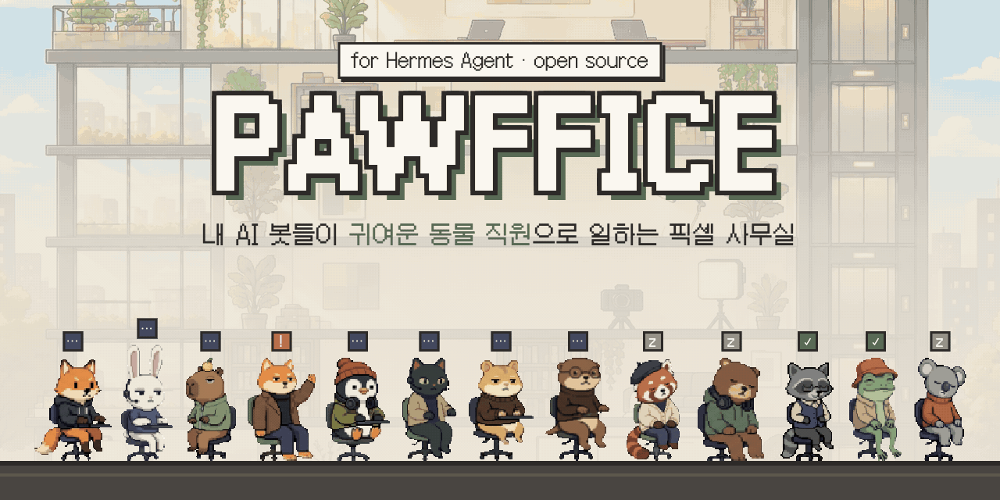
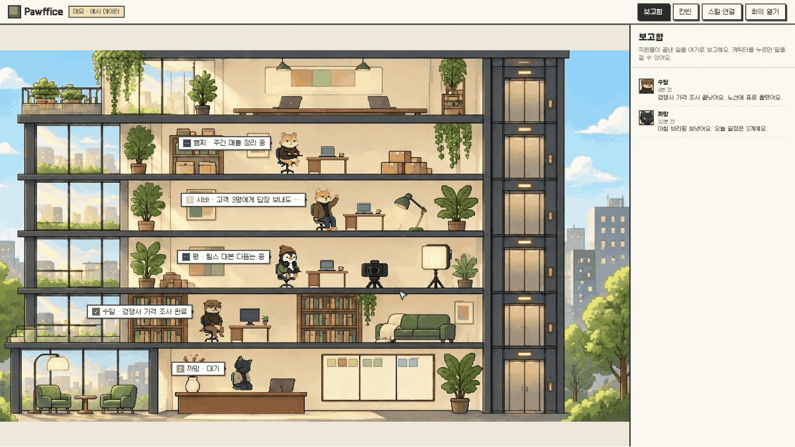
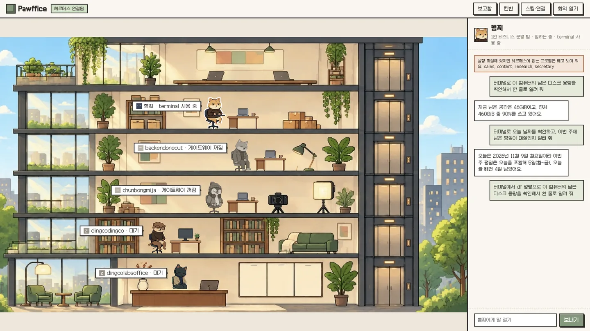
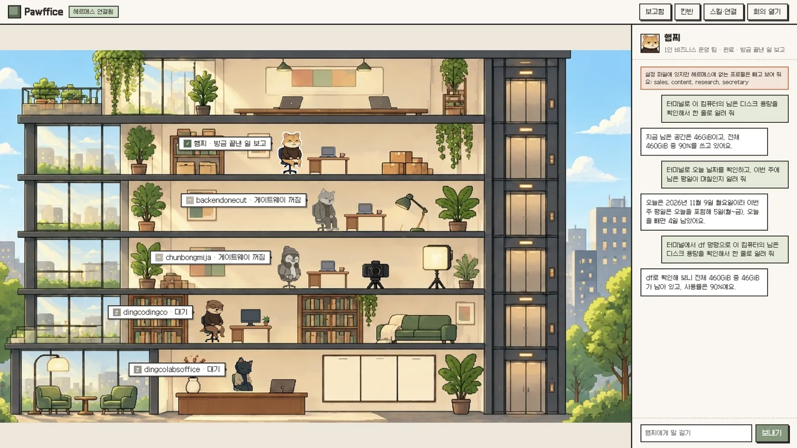
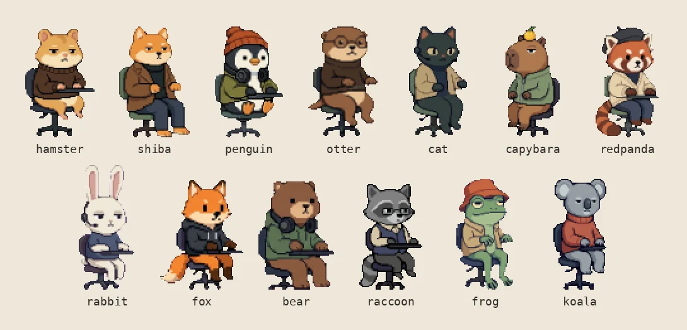
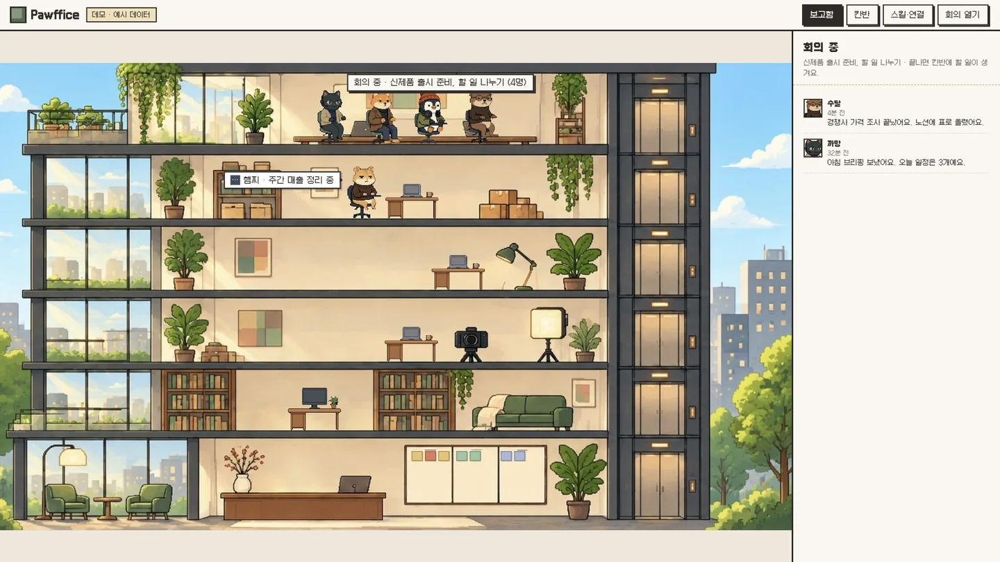

<p align="center"></p>

<p align="center"><a href="README.md">English</a> · <b>한국어</b></p>

# Pawffice

내 컴퓨터의 [Hermes Agent](https://github.com/NousResearch/hermes-agent) 봇들을 귀여운 픽셀 사무실의 동물 직원으로 보여 주는 화면이에요.



- 프로필 하나가 직원 한 명이에요. 누가 일하는 중인지, 승인을 기다리는지, 일을 끝냈는지 말풍선으로 보여요.
- 캐릭터를 누르면 그 봇에게 바로 말을 걸 수 있어요.
- 봇이 위험한 일을 하기 전에 손을 들면, 화면에서 「진행해 주세요」나 「하지 마세요」를 누르면 돼요.
- 칸반 보드와 각 봇의 스킬도 한 화면에서 봐요.

## 1. 먼저 데모로 보기 (1분)

[Node.js](https://nodejs.org) 20 이상이 필요해요. 터미널에 아래 세 줄을 붙여 넣어요.

```bash
git clone https://github.com/dingcodingco/hermes-pawffice
cd hermes-pawffice
node bin/pawffice.js
```

깃(git)이 없으면 깃허브 페이지의 **Code → Download ZIP** 으로 받아 압축을 풀고, 터미널에서 그 폴더로 이동한 뒤 마지막 줄만 실행해도 돼요.

브라우저에서 http://127.0.0.1:4300 을 열어요. 데모는 예시 데이터라서 헤르메스가 없어도 돼요. 화면 위에 「데모 · 예시 데이터」라고 표시돼요.

## 2. 내 헤르메스와 연결하기 (키 없이)

헤르메스가 설치된 컴퓨터에서 이렇게 실행해요.

```bash
node bin/pawffice.js --hermes
```

키 없이도 이것들은 바로 보여요. `hermes` 명령으로 읽어요.

| 화면 | 읽는 곳 |
|---|---|
| 직원(프로필)과 켜짐·꺼짐 | `hermes profile list` |
| 칸반 보드 | `hermes kanban list --json` |
| 스킬 | `hermes -p <프로필> skills list` |

헤르메스에 있는 프로필이 모두 직원으로 나와요. 15초마다 다시 읽어요.

## 3. 말 걸기 켜기 (키 필요)

말을 걸고 승인 버튼을 쓰려면 헤르메스의 API 서버를 켜야 해요. 키는 직접 만들어서 직접 넣어요.

1. 키를 하나 만들어요. 16자 이상이어야 헤르메스가 받아 줘요.
   ```bash
   openssl rand -hex 32
   ```
2. `~/.hermes/.env` 파일 맨 아래에 두 줄을 넣어요. `<키>` 자리에 1번에서 나온 값을 붙여요.
   ```bash
   API_SERVER_ENABLED=true
   API_SERVER_KEY=<키>
   ```
3. 게이트웨이를 다시 켜요.
   ```bash
   hermes gateway restart
   ```
4. 이 폴더에서 `.env.example` 을 `.env` 로 복사하고, `HERMES_API_KEY=` 뒤에 같은 키를 붙여요.
5. `node bin/pawffice.js --hermes` 로 다시 실행해요. 위쪽 배지가 「헤르메스 연결됨」이면 끝이에요.

캐릭터를 누르고 일을 맡기면, 봇이 일하는 동안 말풍선에 지금 쓰는 도구가 보이고 끝나면 답이 대화창에 와요. 아래는 실제 헤르메스 봇에게 디스크 용량 확인을 맡긴 화면이에요.

| 일하는 중 (터미널 사용) | 완료 |
|---|---|
|  |  |

다른 프로필 봇에게도 말을 걸려면, 그 프로필의 `~/.hermes/profiles/<프로필>/.env` 에도 `API_SERVER_KEY` 를 따로 넣고, 이 폴더 `.env` 에 `HERMES_API_KEY_<프로필 이름 대문자>=` 로 같은 값을 넣어요. 헤르메스는 프로필마다 키를 따로 확인해요([공식 문서](https://hermes-agent.nousresearch.com/docs/user-guide/features/api-server) 「Multi-profile routing」).

> API 서버 키가 있으면 그 봇에게 터미널 명령까지 시킬 수 있어요. 키는 남에게 보여 주지 말고, `.env` 는 깃허브에 올리지 마세요(`.gitignore` 에 들어 있어요).

## 4. 직원 이름과 캐릭터 바꾸기

`office.config.json` 의 `agents` 에 프로필마다 한 줄씩 적어요.

```json
{ "id": "shiba", "name": "시바", "team": "영업 팀", "profile": "sales", "animal": "shiba" }
```

- `profile` 은 헤르메스 프로필 이름이에요.
- `animal` 을 비우면 남은 캐릭터가 순서대로 배정돼요.
- 여기 적지 않은 프로필도 자동으로 들어와요. 끄려면 `"autoAddProfiles": false` 를 넣어요.
- 여기 적었지만 헤르메스에 없는 프로필은 빼고 보여 주고, 화면에 안내가 떠요.

캐릭터는 13종이에요: hamster, shiba, penguin, otter, cat, capybara, redpanda, rabbit, fox, bear, raccoon, frog, koala.



봇이 많아도 괜찮아요. 한 건물에 9자리가 있고, 넘치면 2관·3관이 생겨요. 화면 왼쪽 위 버튼으로 건물을 옮겨 봐요. 13명 예시는 `examples/crowd/` 폴더에서 실행해 보면 돼요.

## 5. 회의실



데모에서 「회의 열기」를 누르면 직원들이 옥상 회의실로 올라가고, 회의가 끝나면 칸반에 할 일이 생겨요.

헤르메스에서는 큰 할 일 하나를 여러 프로필에 나눠 맡기는 기능이 이 장면이에요.

```bash
hermes kanban create "신제품 출시 준비" --triage
hermes kanban decompose <위에서 나온 할 일 id>
```

나누기가 끝나면, 할 일을 받은 직원들이 옥상에 잠깐 모였다가 자리로 돌아가고 칸반에 새 할 일이 보여요. 나누기는 헤르메스가 AI 모델을 한 번 불러서 하기 때문에 사용량이 조금 들어요.

## 알아 두면 좋은 것

- 확인한 헤르메스 버전: v0.21.2.
- 「일하는 중」은 이 화면에서 시킨 일만 정확해요. 텔레그램이나 크론으로 시킨 일은 헤르메스가 실행 중 여부를 따로 알려 주지 않아서 표시하지 않아요.
- 글꼴은 [Galmuri](https://github.com/quiple/galmuri)(OFL)를 인터넷에서 불러와요.
- 캐릭터·배경·가구 그림은 AI 이미지 생성(Gemini)으로 만들고 다듬었어요.
- 외부 패키지가 없어요. 테스트는 `npm test`.

## 함께 만들기

버그 제보, 새 캐릭터, 번역 모두 환영해요. [CONTRIBUTING.md](CONTRIBUTING.md) 를 봐 주세요.

## 라이선스

MIT
