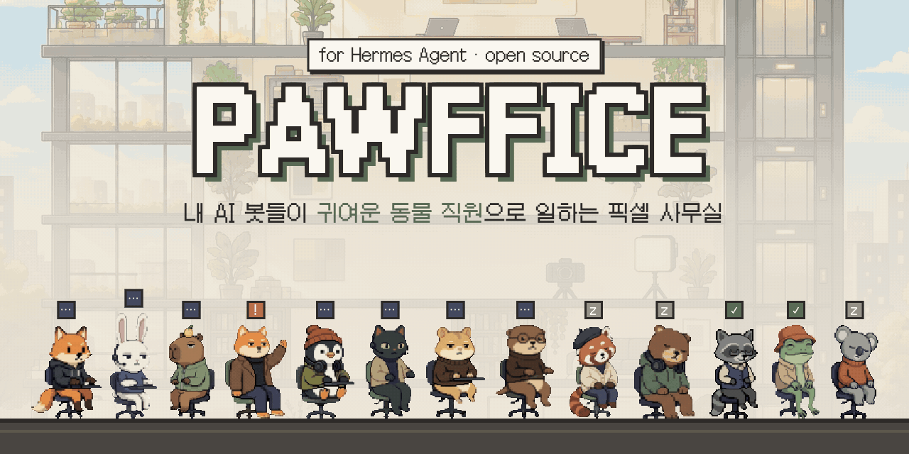
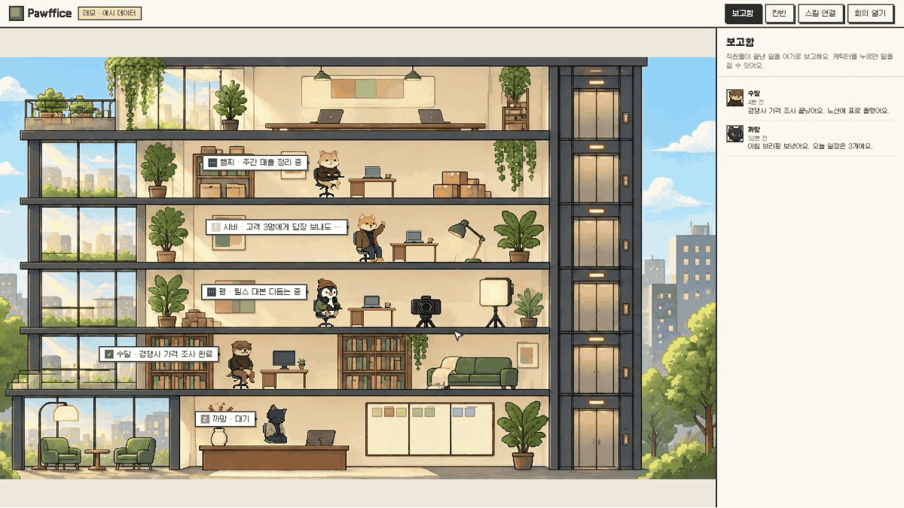
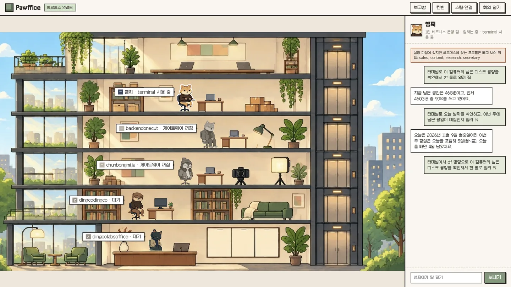
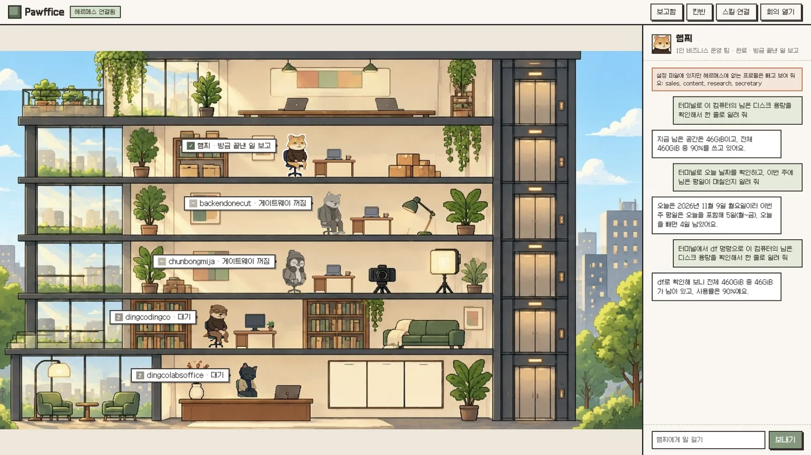
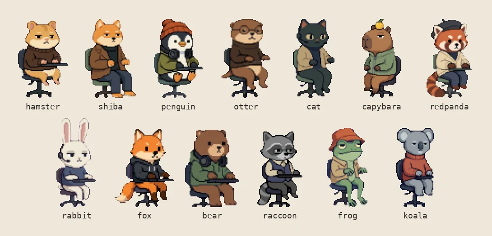
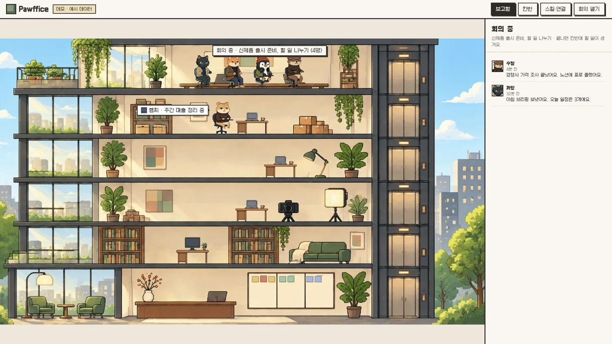

<p align="center"></p>

<p align="center"><b>English</b> · <a href="README.ko.md">한국어</a></p>

<p align="center">
  <a href="https://github.com/dingcodingco/hermes-pawffice/actions/workflows/test.yml"></a>
  = 20">
  
  <a href="LICENSE"></a>
</p>

# Pawffice

**A cute pixel office for your [Hermes Agent](https://github.com/NousResearch/hermes-agent) bots.** Every Hermes profile becomes an animal coworker at a desk. You can see who is working, who needs your approval and who just finished, and you can click a coworker to give it a task.



- **One profile = one coworker.** Speech bubbles show working, needs approval, done and idle.
- **Talk to your bots.** Click a character, type a task, and watch the bubble show the tool it is using.
- **Approve from the office.** When a bot asks before a risky command, press 「진행해 주세요」 (proceed) or 「하지 마세요」 (don't) in the chat panel.
- **Kanban, skills and meetings.** Your Hermes kanban board and each profile's skills are one click away. Splitting a task with `hermes kanban decompose` sends the assignees to the rooftop meeting room.
- **Zero dependencies.** Plain Node.js (20+) and a browser. No build step.

## Quick start (demo, 1 minute)

```bash
git clone https://github.com/dingcodingco/hermes-pawffice
cd hermes-pawffice
node bin/pawffice.js
```

Open http://127.0.0.1:4300. The demo uses sample data, so you do not need Hermes yet. The badge at the top says 「데모 · 예시 데이터」 (demo, sample data).

> The UI text is Korean for now. English UI is the most wanted contribution: see [CONTRIBUTING.md](CONTRIBUTING.md).

## Connect your Hermes (read-only, no key)

On a computer where Hermes is installed:

```bash
node bin/pawffice.js --hermes
```

Without any key, Pawffice reads these with the `hermes` CLI every 15 seconds:

| In the office | Read from |
|---|---|
| Coworkers (profiles) and on/off | `hermes profile list` |
| Kanban board | `hermes kanban list --json` |
| Skills | `hermes -p <profile> skills list` |

## Talk to your bots (API key)

Chatting and approvals use the Hermes API server. Make the key yourself and keep it private.

1. Create a key (Hermes needs 16+ characters).
   ```bash
   openssl rand -hex 32
   ```
2. Add two lines to the end of `~/.hermes/.env`.
   ```bash
   API_SERVER_ENABLED=true
   API_SERVER_KEY=<your key>
   ```
3. Restart the gateway.
   ```bash
   hermes gateway restart
   ```
4. In this folder, copy `.env.example` to `.env` and put the same key after `HERMES_API_KEY=`.
5. Run `node bin/pawffice.js --hermes` again. The badge should say 「헤르메스 연결됨」 (connected).

This is a real Hermes bot checking free disk space from the office:

| Working (using the terminal) | Done |
|---|---|
|  |  |

To chat with other profiles, add `API_SERVER_KEY` to `~/.hermes/profiles/<profile>/.env` as well, and add `HERMES_API_KEY_<PROFILE>=` with the same value to this folder's `.env`. Hermes checks keys per profile ([docs: Multi-profile routing](https://hermes-agent.nousresearch.com/docs/user-guide/features/api-server)).

> Anyone with this key can make the bot run terminal commands. Never share it, and never commit `.env` (it is already in `.gitignore`).

### Approval cards

Hermes decides when to ask. With the default `approvals.mode: smart`, a helper model auto-approves commands it judges low-risk, so you may not see a card. To be asked every time, set this in `~/.hermes/config.yaml` and restart the gateway:

```yaml
approvals:
  mode: manual
```

## Names and characters

Edit `agents` in `office.config.json`, one line per profile:

```json
{ "id": "shiba", "name": "Shiba", "team": "Sales", "profile": "sales", "animal": "shiba" }
```

- `profile` is the Hermes profile name.
- Leave out `animal` and the next free character is assigned.
- Profiles you did not list are added automatically. Turn this off with `"autoAddProfiles": false`.
- Listed profiles that do not exist in Hermes are hidden, with a note on screen.

13 characters: hamster, shiba, penguin, otter, cat, capybara, redpanda, rabbit, fox, bear, raccoon, frog, koala.



Each building has 9 desks. More bots open building 2, 3 and so on (buttons at the top left). Try 13 bots:

```bash
cd examples/crowd && node ../../bin/pawffice.js
```

## Meeting room



In the demo, press 「회의 열기」 (open meeting). With Hermes, the meeting is what happens when you split one task across profiles:

```bash
hermes kanban create "Prepare the product launch" --triage
hermes kanban decompose <task id>
```

The assignees gather on the rooftop for a moment, return to their desks, and the new tasks appear on the kanban board. Decompose calls your AI model once, so it uses a little quota.

## Good to know

- Tested with Hermes Agent v0.21.2.
- "Working" is exact only for tasks started from this office. Hermes does not report live status for tasks started from Telegram or cron.
- Font: [Galmuri](https://github.com/quiple/galmuri) (OFL), loaded from a CDN.
- Characters, background and furniture were made with AI image generation (Gemini) and cleaned up by hand.
- Tests: `npm test`.

## Contributing

Bug reports, new characters, translations and new office themes are all welcome. Start with [CONTRIBUTING.md](CONTRIBUTING.md). Issues labeled `good first issue` are a good place to begin.

## License

[MIT](LICENSE)
